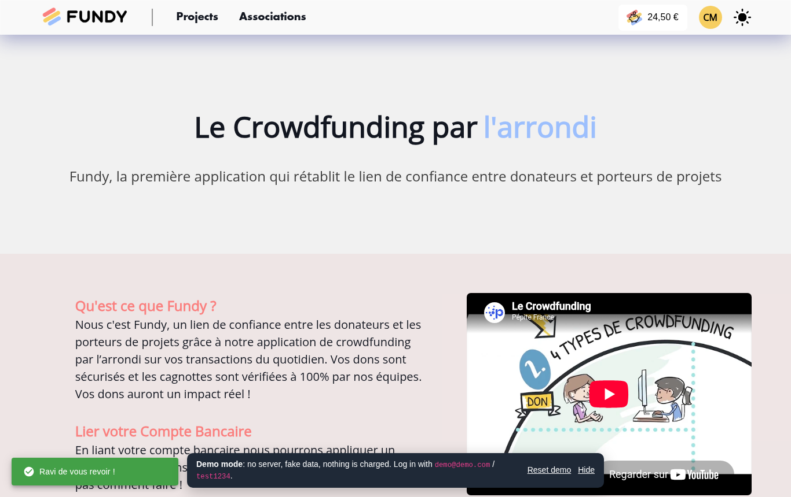
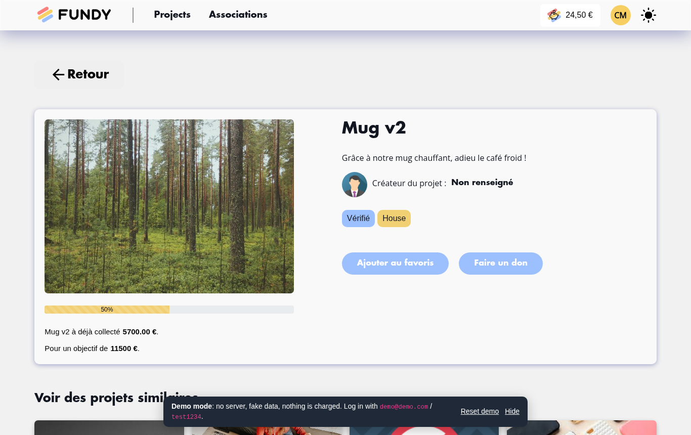
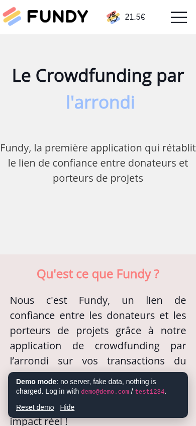

# Fundy

> Round up your everyday card payments and give the spare change to associations and projects you care about.

Fundy links to a user's bank account, rounds each card payment up to the next euro (or a chosen step), and collects the difference in a piggy bank that the user can donate to verified associations and crowdfunding projects.

**EPITECH Innovative Project (EIP), 2020–2023**, built by a team of students. This repository is a cleaned-up portfolio copy of the original team repositories: same code, with secrets moved to environment variables and a static demo mode added.

**▶ Live demo: [fundy.cyrildelajudie.fr](https://fundy.cyrildelajudie.fr)** — runs entirely in the browser on fake data, nothing is charged. Log in with `demo@demo.com` / `test1234` (pre-filled).

| Home | Project | Mobile width |
|---|---|---|
|  |  |  |

## What's inside

| Folder | What | Stack |
|---|---|---|
| [`backend/`](backend) | REST API: auth, associations, projects, donations, bank linking, round-up charging | Node, Express, TypeScript, Prisma, PostgreSQL, Redis |
| [`web/`](web) | Donor web app (+ static demo mode) | React 17, webpack, styled-components, Material UI |
| [`dashboard/`](dashboard) | Partner dashboard where associations manage their page and projects | React 17, TypeScript (CRA) |
| [`mobile/`](mobile) | Donor mobile app | Expo / React Native, TypeScript |
| [`site/`](site) | Landing page | Vue, Vite, Tailwind |
| [`infra/nginx/`](infra/nginx) | Original production reverse-proxy config (one vhost per subdomain) | nginx |

## Architecture

```
 web (React) ─┐
 dashboard ───┼── HTTPS, cookie session ──► backend (Express) ──► PostgreSQL (Prisma)
 mobile (Expo)┘                                │      │
                                               │      └──► Redis (sessions)
                                               ├──► Nordigen  (open banking: read card transactions)
                                               ├──► Stripe    (SEPA debit of round-ups, card donations)
                                               └──► Expo push / Gmail (notifications, emails)
```

- The backend is organised by feature (`backend/src/components/<feature>/`), each with `routes.ts` (Express router), `controllers.ts` (logic + Prisma queries) and `entities.ts` (class-validator DTOs). Third-party integrations live in `backend/src/services/`.
- A cron job (`backend/src/transactionsCron.ts`) walks active bank accounts, computes the round-ups and creates the Stripe debits.
- In production everything ran on a single DigitalOcean droplet: Docker Compose for the API, Postgres, Redis and a Grafana / Loki / Promtail stack, behind nginx (`infra/nginx/`), deployed by GitHub Actions on push.

## Demo mode (no backend needed)

The donor web app can run fully in the browser: a fake API (`web/src/api/mock/`) replaces the HTTP layer and answers every request with seeded data that mirrors the real API. Logging in, browsing, following, donating from the piggy bank or by card, and linking a bank account all work, and the state survives page reloads (it is stored in `localStorage`).

```sh
cd web
npm ci --ignore-scripts
npm run start:demo     # dev server on http://localhost:3000
npm run build:demo     # static build in web/dist/
```

`web/dist/` can be hosted on any static host. On Vercel, import the repo with **Root Directory** `web`: `web/vercel.json` sets the build and the SPA rewrite. On Netlify / Cloudflare Pages, `web/public/_redirects` makes deep links work. Normal builds (`npm run build`) do not include the mock.

## Running the real stack

```sh
cd backend
cp .env.example .env                 # fill in, then export the variables (direnv, dotenv, …)
mkdir -p https && openssl req -x509 -newkey rsa:2048 -nodes -days 365 -subj "/CN=localhost" \
  -keyout https/privkey.pem -out https/fullchain.pem   # the server also listens on HTTPS :8001
docker-compose up -d postgres redis
npm install
npm run db:up                        # apply Prisma migrations
npm run start:dev                    # http://localhost:8000
```

- `npm run db:seed` loads sample associations, projects and a demo user. It calls Stripe, so it needs `STRIPE_SECRET_KEY` (a test key).
- Bank linking, card payments and emails need your own Nordigen, Stripe and Gmail credentials (see `backend/.env.example`).
- Each frontend has a `.env.example` with the API URL to point at.

## Team

Built over 5 sprints (2021–2023) by a team of EPITECH students. The [project history](docs/PROJECT_HISTORY.md) covers the timeline, the key technical decisions and how the team worked.

| Member | Main contributions |
|---|---|
| **Cyril de Lajudie** ([@Axoloot](https://github.com/Axoloot)) | **DevOps and mobile.** CI/CD pipelines for every app (build, test, deploy with GitHub Actions); production setup (Docker Compose, nginx, domain and TLS), first on DigitalOcean, then migrated to Azure to cut hosting costs; monitoring with Prometheus, Grafana and Loki. Main contributor to the mobile app: sign-up, push notifications, Nordigen bank linking, in-app tutorial, Firebase analytics, Jest tests and linting. On the backend: round-up cron, transaction notifications, HTTPS server. |
| **Vincent Lemesle** | **Backend lead.** Most of the API: auth and partner (B2B) auth, bank accounts and the round-up system with Nordigen and Stripe, card payments, password reset, featured projects, error handling with translation keys, API test suite. Also built the partner dashboard features. |
| **Antoine Famibelle** | **Web app lead.** UX/UI redesign and v3 mockups, responsive layout, translations (FR / EN / ES), web CI and usage metrics, landing page. |
| **Jérémy Groizard** | **Web app.** v3 interface, association actions feed, card donations, UI component library, tests. |
| **Grégoire Brasseur** | **Mobile app and design.** Dark mode, languages, association pages, card donations and donation history, animations, UI consistency between web and mobile, tests. |
| **Laurane Sevin** | **Partner dashboard and backend.** Dashboard mockups and implementation (association and project management), partner auth with Vincent, test environment. |
| **Robin Christol** | **Backend** in the early sprints. |

## License

[MIT](LICENSE) © 2020–2023 Fundy EIP team (originally Buddy-EIP)
